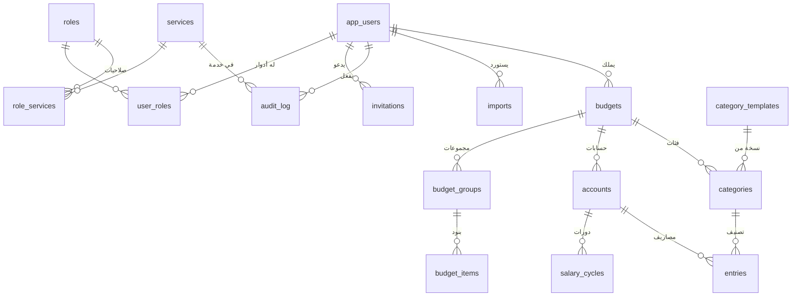

# قاعدة بيانات M-SAL2.0

> نتيجة جلسة التخطيط 2 (2026-10-31). مبنية على [BUSINESS_RULES.md](BUSINESS_RULES.md).
> ملفات SQL هنا **مسودة**. في مرحلة التنفيذ 1 تُنسخ إلى `backend/src/main/resources/db/migration/` وتُراجع.

## المحتويات

1. [القرارات الأساسية](#1-القرارات-الأساسية)
2. [رسم العلاقات](#2-رسم-العلاقات)
3. [الجداول بالتفصيل](#3-الجداول-بالتفصيل)
4. [ما تضمنه قاعدة البيانات وما يضمنه السيرفر](#4-ما-تضمنه-قاعدة-البيانات-وما-يضمنه-السيرفر)
5. [استعلامات مهمة](#5-استعلامات-مهمة)
6. [نقل البيانات من M-SAL القديم](#6-نقل-البيانات-من-m-sal-القديم)
7. [ملفات Flyway (مسودة)](#7-ملفات-flyway-مسودة)
8. [ملاحظات لمرحلة التنفيذ](#8-ملاحظات-لمرحلة-التنفيذ)

---

## 1. القرارات الأساسية

| # | القرار | السبب |
|---|---|---|
| D-01 | كل الجداول في schema اسمه **`msal`** وليس `public` | Supabase يفتح `public` تلقائياً عبر API عام (PostgREST). نضع جداولنا في schema غير مفتوح، حتى لا يصل لها أحد إلا عن طريق Spring Boot |
| D-02 | **RLS مفعّل** على كل جدول بدون أي policy | حماية إضافية. لو فُتح الـ schema بالخطأ، لا أحد يقرأ شيئاً. Spring Boot يتصل بالمستخدم المالك للجداول، فلا يتأثر |
| D-03 | **لا FK إلى `auth.users`** الخاص بـ Supabase | حتى تعمل نفس ملفات Flyway على Postgres محلي في Docker بدون Supabase. الربط: `app_users.id` = قيمة `sub` في JWT |
| D-04 | **`user_id` في كل جدول بيانات**، مع **FK مركّب** `(parent_id, user_id)` | قاعدة البيانات نفسها تمنع أن يرتبط سجل بسجل مستخدم آخر، حتى لو أخطأ الكود |
| D-05 | **UUID** لكل سجل، مع استثناءين: جداول المرجع (`services` و`roles` و`category_templates`) مفتاحها كود ثابت، و`audit_log` مفتاحه رقم متسلسل | الأكواد الثابتة أوضح، وسجل النشاط يُكتب فقط ولا يُعدَّل، والترتيب الزمني فيه مهم |
| D-06 | **حُذف جدول `budget_months`** من الخطة المبدئية | التطبيق القديم لا يحفظ تاريخ الأشهر: "شهر جديد" يمسح علامات الصرف ويغيّر الاسم فقط (R-BUD-05). مبدأ المطابقة أولاً. يمكن إضافة سجل الأشهر لاحقاً بملف Flyway جديد |
| D-07 | **الحذف حسب نوع البيانات** (تفصيل للقاعدة 8 في `CLAUDE.md`) | انظر الجدول أدناه |
| D-08 | **عمود `legacy_id`** في كل جدول يأتي من التطبيق القديم | لتعمل طريقة "الدمج" في الاستيراد (R-IO-03)، ولا تتكرر البيانات إذا استُورد نفس الملف مرتين |
| D-09 | جدول **`imports`** يحفظ ملف الاستيراد الأصلي كاملاً | لا تضيع أي معلومة، حتى الحقول غير المعروفة (R-IO-04)، ونقدر نرجع للملف الأصلي دائماً |
| D-10 | جدول **`category_templates`** للفئات الافتراضية | الفئات الـ 20 واقتراحات "ريوق، غدا، عشا" تُعدَّل من قاعدة البيانات بدون تعديل كود. كل ميزانية جديدة تأخذ نسخة منها |
| D-11 | عمود **`version`** في الجداول القابلة للتعديل | قفل تفاؤلي (`@Version` في JPA): لو عدّلت نفس السجل من جهازين في نفس الوقت، الثاني يُرفض بدل أن يمسح تعديل الأول |
| D-12 | **`updated_at` يُحدَّث من Spring** (JPA Auditing) وليس بـ triggers | ملفات SQL أبسط، والمنطق كله في Java |
| D-13 | **الانتماء للدورة لا يُخزَّن** في جدول المصاريف | يُحسب من التاريخ دائماً (R-CYC-01)، فتغيير تاريخ الدورة لا يحتاج تعديل أي مصروف |
| D-14 | **`time_zone`** لكل مستخدم (افتراضياً `Asia/Dubai`) | "اليوم" يُحسب بتوقيت المستخدم (القاعدة 14) |

### D-07: طريقة الحذف لكل نوع

| البيانات | الطريقة | السبب |
|---|---|---|
| المصاريف (`entries`) | **حذف مؤقت** (`deleted_at`) | المستخدم يرى "المحذوفات" ويستعيد منها (R-ENT-09) |
| الميزانيات (`budgets`) | **حذف مؤقت** (`deleted_at`) | حذف ميزانية يمسح كل شيء تحتها، فالأمان أهم |
| الحسابات (`accounts`) | **أرشفة** (`is_archived`)، لا حذف | مطابق للتطبيق القديم (R-ACC) |
| الفئات (`categories`) | **إخفاء** (`is_hidden`)، لا حذف | مطابق للتطبيق القديم (R-CAT) |
| المجموعات والبنود والدورات | **حذف فعلي** + نسخة من البيانات في `audit_log.before_data` | مطابق للتطبيق القديم، ونقدر نستعيدها يدوياً من سجل النشاط |
| الحذف النهائي من "المحذوفات" | **حذف فعلي** + نسخة في `audit_log.before_data` | طلب صريح من المستخدم |

---

## 2. رسم العلاقات



**بالكلمات:**
```
المستخدم
 └── الميزانيات ("الأشخاص" في التطبيق القديم)
      ├── المجموعات ← البنود                    (الميزانية الشهرية، SRV-002)
      ├── الحسابات ← دورات الراتب               (SRV-004، SRV-003)
      ├── الفئات                                (SRV-005)
      └── المصاريف ← مربوطة بحساب وفئة           (SRV-001)
```

---

## 3. الجداول بالتفصيل

**أعمدة مشتركة** في أغلب الجداول (لا تُكرر في الشرح):

| العمود | النوع | الوصف |
|---|---|---|
| `created_at` | `timestamptz` | وقت الإنشاء |
| `updated_at` | `timestamptz` | وقت آخر تعديل (يحدّثه Spring) |
| `version` | `integer` | للقفل التفاؤلي (D-11) |
| `legacy_id` | `text` | المعرّف في التطبيق القديم، إن وُجد (D-08) |

### 3.1 جداول النظام

#### `services`: أكواد الخدمات
| العمود | النوع | القيود | الوصف |
|---|---|---|---|
| `code` | `varchar(7)` | PK، الشكل `SRV-000` | كود الخدمة |
| `name_ar` | `text` | مطلوب | الاسم بالعربي |
| `name_en` | `text` | مطلوب | الاسم بالإنجليزي (للسجلات) |
| `enabled` | `boolean` | افتراضياً `true` | إيقاف الخدمة بدون تعديل كود |

#### `roles`: الأدوار
| العمود | النوع | الوصف |
|---|---|---|
| `code` | `varchar(20)` PK | `USER` أو `ADMIN` |
| `name_ar` | `text` | "مستخدم" أو "مدير" |

#### `role_services`: صلاحيات كل دور على كل خدمة
| العمود | النوع | الوصف |
|---|---|---|
| `role_code` | FK ← `roles` | الدور |
| `service_code` | FK ← `services` | الخدمة |
| `can_read` | `boolean` | قراءة |
| `can_write` | `boolean` | إضافة وتعديل وحذف |

PK مركّب: `(role_code, service_code)`.

**الصلاحيات المبدئية:**

| الخدمة | USER | ADMIN |
|---|---|---|
| SRV-000 الحساب والجلسة (أُضيفت في جلسة التخطيط 3) | قراءة + كتابة | — |
| SRV-001 المصاريف | قراءة + كتابة | — |
| SRV-002 الميزانية الشهرية | قراءة + كتابة | — |
| SRV-003 دورات الراتب | قراءة + كتابة | — |
| SRV-004 الحسابات | قراءة + كتابة | — |
| SRV-005 الفئات | قراءة + كتابة | — |
| SRV-006 الإحصاءات | قراءة | — |
| SRV-007 الاستيراد والتصدير | قراءة + كتابة | — |
| SRV-008 الإيصال | قراءة | — |
| SRV-009 إدارة المستخدمين | — | قراءة + كتابة |

المدير يُعطى **الدورين معاً** (`USER` و`ADMIN`)، فيستخدم التطبيق كأي مستخدم، ومعه إدارة المستخدمين.

#### `app_users`: المستخدمون
| العمود | النوع | القيود | الوصف |
|---|---|---|---|
| `id` | `uuid` | PK | **نفس `sub` في JWT من Supabase** (D-03) |
| `email` | `text` | مطلوب، فريد (بدون حساسية للأحرف) | البريد |
| `display_name` | `text` | اختياري | الاسم الظاهر |
| `time_zone` | `text` | افتراضياً `Asia/Dubai` | لحساب "اليوم" (D-14) |
| `status` | `text` | `ACTIVE` أو `DISABLED` | المستخدم المعطّل لا يدخل. **المستخدمون لا يُحذفون** حتى يبقى سجل النشاط سليماً |
| `last_budget_id` | `uuid` | FK مركّب ← `budgets` | آخر ميزانية مفتوحة (`currentId` في القديم) |
| `last_export_at` | `timestamptz` | اختياري | آخر تصدير، لتذكير التصدير كل 14 يوماً (R-IO-01). أُضيف في جلسة التخطيط 3 |

#### `user_roles`: أدوار كل مستخدم
PK مركّب: `(user_id, role_code)`.

#### `invitations`: الدعوات (SRV-009)
| العمود | النوع | الوصف |
|---|---|---|
| `id` | `uuid` PK | |
| `email` | `text` | البريد المدعو |
| `role_code` | FK ← `roles` | افتراضياً `USER` |
| `status` | `text` | `PENDING`، أو `ACCEPTED`، أو `REVOKED`، أو `EXPIRED` |
| `invited_by` | FK ← `app_users` | من أرسل الدعوة |
| `expires_at` | `timestamptz` | انتهاء الدعوة |
| `accepted_at` | `timestamptz` | وقت القبول |

- **دعوة معلّقة واحدة فقط لكل بريد** (فهرس فريد جزئي).
- **طريقة الدعوة نفسها** (عن طريق Supabase Auth) في [API.md](API.md) القسم 2.3.

#### `audit_log`: سجل النشاط
| العمود | النوع | الوصف |
|---|---|---|
| `id` | `bigint` PK متسلسل | |
| `occurred_at` | `timestamptz` | متى |
| `user_id` | FK ← `app_users` | من (فارغ للعمليات الآلية) |
| `service_code` | FK ← `services` | أي خدمة |
| `action` | `text` | مثل `CREATE` و`UPDATE` و`DELETE` و`RESTORE` و`PURGE` و`IMPORT` و`NEW_MONTH` |
| `entity_type` | `text` | مثل `entry` و`budget_group` |
| `entity_id` | `uuid` | أي سجل |
| `before_data` | `jsonb` | البيانات قبل التغيير (إلزامي في الحذف الفعلي، D-07) |
| `after_data` | `jsonb` | البيانات بعد التغيير |
| `request_id` | `text` | يربط السطر بسجلات الاستضافة |

- **يُكتب فقط، ولا يُعدَّل ولا يُحذف.**
- **بديل "اللقطات" في التطبيق القديم** (R-IO-05): قبل أي عملية خطرة تُحفظ البيانات في `before_data`.

#### `imports`: ملفات الاستيراد (SRV-007)
| العمود | النوع | الوصف |
|---|---|---|
| `id` | `uuid` PK | |
| `user_id` | FK ← `app_users` | |
| `file_name` | `text` | اسم الملف |
| `mode` | `text` | `MERGE` (دمج) أو `REPLACE` (استبدال) |
| `raw_data` | `jsonb` | **الملف الأصلي كاملاً** (D-09) |
| `counts` | `jsonb` | الأعداد المستوردة |
| `warnings` | `jsonb` | تحذيرات، مثل تاريخ غير صالح تم إصلاحه |

### 3.2 الميزانية الشهرية (SRV-002)

#### `budgets`: الميزانيات ("الأشخاص")
| العمود | النوع | القيود | الوصف |
|---|---|---|---|
| `id` | `uuid` | PK | |
| `user_id` | `uuid` | FK ← `app_users` | المالك |
| `name` | `text` | غير فارغ | اسم الميزانية |
| `month_label` | `text` | | اسم الشهر، مثل "نوفمبر 2026" |
| `salary_label` | `text` | افتراضياً "الراتب" | مسمى الراتب |
| `salary_amount` | `numeric(12,2)` | اختياري، **يقبل السالب** | الراتب (R-BUD-03) |
| `salary_is_approx` | `boolean` | | الراتب تقريبي `~` (R-BUD-02) |
| `sort_order` | `integer` | | ترتيب الميزانيات |
| `last_account_id` | `uuid` | FK مركّب ← `accounts` | آخر حساب استُخدم |
| `deleted_at` | `timestamptz` | | حذف مؤقت |

#### `budget_groups`: المجموعات
| العمود | النوع | القيود | الوصف |
|---|---|---|---|
| `id` | `uuid` | PK | |
| `user_id` + `budget_id` | `uuid` | FK مركّب ← `budgets`، حذف متتالٍ | |
| `title` | `text` | | اسم المجموعة (يقبل الفارغ) |
| `sort_order` | `integer` | | الترتيب، والرقم `01`، `02` يُحسب منه |

#### `budget_items`: البنود
| العمود | النوع | القيود | الوصف |
|---|---|---|---|
| `id` | `uuid` | PK | |
| `user_id` + `group_id` | `uuid` | FK مركّب ← `budget_groups`، حذف متتالٍ | |
| `name` | `text` | | اسم البند (يقبل الفارغ) |
| `amount` | `numeric(12,2)` | اختياري، **يقبل السالب** | الفارغ = `null` ويُحسب 0 |
| `is_approx` | `boolean` | | تقريبي `~` |
| `is_done` | `boolean` | | "تم الصرف"، ولا يؤثر على الحساب (R-BUD-01) |
| `sort_order` | `integer` | | الترتيب |

### 3.3 المصاريف

#### `category_templates`: الفئات الافتراضية (مرجع)
| العمود | النوع | الوصف |
|---|---|---|
| `code` | `text` PK | مثل `cat_food` |
| `name_ar` | `text` | "أكل ومطاعم" |
| `emoji` | `text` | 🍔 |
| `sort_order` | `integer` | الترتيب الافتراضي |
| `default_suggestions` | `text[]` | `{ريوق,غدا,عشا}` لفئة الأكل فقط (R-ENT-12) |

#### `accounts`: الحسابات (SRV-004)
| العمود | النوع | القيود | الوصف |
|---|---|---|---|
| `id` | `uuid` | PK | |
| `user_id` + `budget_id` | `uuid` | FK مركّب ← `budgets` | |
| `name` | `text` | غير فارغ | مثل "مصاريفي" |
| `is_archived` | `boolean` | | مؤرشف |
| `sort_order` | `integer` | | الترتيب |

#### `categories`: الفئات (SRV-005)
| العمود | النوع | القيود | الوصف |
|---|---|---|---|
| `id` | `uuid` | PK | |
| `user_id` + `budget_id` | `uuid` | FK مركّب ← `budgets` | |
| `code` | `text` | FK ← `category_templates`، اختياري | للفئات الافتراضية فقط، وفريد داخل الميزانية |
| `name` | `text` | مطلوب | الاسم |
| `emoji` | `text` | افتراضياً 📦 | الرمز |
| `is_hidden` | `boolean` | | مخفية |
| `sort_order` | `integer` | | الترتيب |

#### `salary_cycles`: دورات الراتب (SRV-003)
| العمود | النوع | القيود | الوصف |
|---|---|---|---|
| `id` | `uuid` | PK | |
| `user_id` + `account_id` | `uuid` | FK مركّب ← `accounts` | **الدورة تابعة للحساب** |
| `start_date` | `date` | مطلوب | تاريخ وصول الراتب |
| `allowance` | `numeric(12,2)` | `>= 0` | المبلغ المخصَّص |
| `expected_next_salary_date` | `date` | اختياري، **بعد** `start_date` | تاريخ الراتب القادم المتوقع |

- **قيد فريد:** `(account_id, start_date)`، فلا تتكرر دورتان بنفس التاريخ في نفس الحساب (R-CYC-03).
- **نهاية الدورة لا تُخزَّن**، بل تُحسب من بداية الدورة التالية (R-CYC-01).

#### `entries`: المصاريف والدخل (SRV-001)
| العمود | النوع | القيود | الوصف |
|---|---|---|---|
| `id` | `uuid` | PK | |
| `user_id` + `budget_id` | `uuid` | FK مركّب ← `budgets` | |
| `account_id` | `uuid` | FK مركّب `(account_id, budget_id)` ← `accounts` | الحساب **من نفس الميزانية** |
| `category_id` | `uuid` | FK مركّب `(category_id, budget_id)` ← `categories` | الفئة **من نفس الميزانية** |
| `type` | `text` | `EXPENSE` أو `INCOME` | النوع |
| `amount` | `numeric(12,2)` | `> 0` و`<= 999,999,999` | المبلغ (R-ENT-03) |
| `name` | `text` | مطلوب (يقبل الفارغ للبيانات القديمة) | الوصف. **الجديد لازم غير فارغ** (يتحقق منه السيرفر، R-ENT-02) |
| `entry_date` | `date` | مطلوب | التاريخ |
| `deleted_at` | `timestamptz` | | حذف مؤقت |

---

## 4. ما تضمنه قاعدة البيانات وما يضمنه السيرفر

| القاعدة | قاعدة البيانات | السيرفر |
|---|---|---|
| كل سجل مربوط بمالكه، ولا يرتبط بسجل مستخدم آخر | ✅ FK مركّب (D-04) | ✅ الهوية من JWT |
| المصروف وحسابه وفئته من نفس الميزانية | ✅ FK مركّب | |
| مبلغ المصروف موجب وضمن الحد | ✅ `CHECK` | ✅ برسالة خطأ واضحة |
| مبلغ الدورة لا يكون سالباً | ✅ `CHECK` | ✅ |
| تاريخ الراتب القادم بعد بداية الدورة | ✅ `CHECK` | ✅ |
| لا تتكرر دورتان بنفس التاريخ | ✅ قيد فريد | ✅ برسالة خطأ واضحة |
| اسم الميزانية والحساب غير فارغ | ✅ `CHECK` | ✅ |
| وصف المصروف الجديد غير فارغ | | ✅ (القديم قد يكون فارغاً) |
| لا يمكن حذف آخر ميزانية | | ✅ (R-BUD-06) |
| لا يمكن أرشفة آخر حساب نشط | | ✅ (R-ACC) |
| حساب الدورات و"كم تقدر تصرف اليوم" | | ✅ (R-CYC-04) |

**القاعدة العامة:** قاعدة البيانات تمنع **البيانات المستحيلة**، والسيرفر يطبّق **قواعد العمل** ويعطي **رسائل خطأ واضحة**.

---

## 5. استعلامات مهمة

### 5.1 حدود كل دورة في حساب (R-CYC-01)
```sql
select id,
       start_date,
       lead(start_date) over (order by start_date, id)          as end_exclusive,
       lead(start_date) over (order by start_date, id) - 1      as last_day,
       lead(start_date) over (order by start_date, id) is null  as is_open
from msal.salary_cycles
where account_id = :accountId
order by start_date, id;
```

### 5.2 مصاريف دورة واحدة
```sql
select *
from msal.entries
where account_id = :accountId
  and deleted_at is null
  and entry_date >= :startDate
  and (:endExclusive is null or entry_date < :endExclusive);
```
يستخدم الفهرس `ix_entries_account_date`.

### 5.3 مصاريف "بدون دورة"
```sql
select *
from msal.entries
where account_id = :accountId
  and deleted_at is null
  and entry_date < (select min(start_date) from msal.salary_cycles where account_id = :accountId);
```
إذا لا توجد دورات أصلاً، كل المصاريف "بدون دورة".

**ملاحظة:** الحسابات نفسها (الملخص، و"كم تقدر تصرف اليوم"، والإحصاءات) تتم في **Java** حسب `BUSINESS_RULES.md`، وليس في SQL. الاستعلامات تجلب البيانات فقط.

---

## 6. نقل البيانات من M-SAL القديم

### 6.1 خريطة الحقول

| في ملف M-SAL القديم | في M-SAL2.0 | ملاحظات |
|---|---|---|
| `currentId` | `app_users.last_budget_id` | |
| `profiles[]` | `budgets` | `id` ← `legacy_id` |
| `profiles[].name` | `budgets.name` | الفارغ يصير "بدون اسم" |
| `data.monthLabel` | `budgets.month_label` | |
| `data.salaryLabel` | `budgets.salary_label` | |
| `data.salary` (نص) | `budgets.salary_amount` + `salary_is_approx` | يُحلَّل حسب R-BUD-03. `"~15000"` ← `15000` + `true` |
| `data.blocks[]` | `budget_groups` | الترتيب في المصفوفة ← `sort_order` |
| `blocks[].rows[]` | `budget_items` | `amount` نص ← `amount` + `is_approx`، و`done` ← `is_done` |
| `data.exp.accounts[]` | `accounts` | `archived` ← `is_archived` |
| `accounts[].cycles[]` | `salary_cycles` | `startDate` ← `start_date`، و`allowance`، و`expectedNextSalaryDate` |
| `data.exp.lastAccountId` | `budgets.last_account_id` | |
| `data.exp.categories[]` | `categories` | إذا `id` من الفئات الـ 20 ← `code` أيضاً. والترتيب ← `sort_order` |
| `data.exp.entries[]` | `entries` | انظر 6.2 |
| `entries[].type` | `entries.type` | `"income"` ← `INCOME`، وغير ذلك ← `EXPENSE` |
| `entries[].createdAt` (مللي ثانية) | `entries.created_at` | يتحول إلى `timestamptz` |
| `entries[].updatedAt` / `deletedAt` | `updated_at` / `deleted_at` | نفس التحويل |
| الملف كاملاً | `imports.raw_data` | الحقول غير المعروفة محفوظة هنا (D-09) |

### 6.2 حالات خاصة في المصاريف

| الحالة | المعالجة | تُسجَّل في `imports.warnings` |
|---|---|---|
| حساب المصروف غير موجود | يُربط **بأول حساب** (R-ENT-13) | ✅ |
| فئة المصروف غير موجودة | تُربط بفئة **"أخرى"** (`cat_other`)، وتُنشأ إذا لم توجد | ✅ |
| تاريخ غير صالح | يُستخدم تاريخ `createdAt`، وإلا تاريخ الاستيراد | ✅ |
| مبلغ غير صالح أو صفر | **لا يُستورد** المصروف، لكنه يبقى محفوظاً في `raw_data` | ✅ |
| وصف فارغ | يُستورد كما هو، ويُعرض باسم الفئة (R-ENT-01) | |

### 6.3 الدمج والاستبدال (R-IO-03)

- **الدمج (`MERGE`):** لكل سجل في الملف، يُبحث عن `legacy_id` في نفس المكان (الميزانية، أو الحساب، أو المجموعة). إذا موجود يُتخطى، وإلا يُضاف. والدورة تُتخطى أيضاً إذا توجد دورة بنفس `start_date` في نفس الحساب.
- **الاستبدال (`REPLACE`):** بيانات الميزانية تُستبدل بالملف (بعد حفظ نسخة في `audit_log.before_data`). وإذا الملف ليس فيه قسم مصاريف لميزانية معيّنة، تبقى مصاريفها كما هي.
- **صيغة ملف التصدير في M-SAL2.0** وطريقة مطابقة المعرّفات عند استيراد ملف من M-SAL2.0 نفسه في [API.md](API.md) القسم 6.

---

## 7. ملفات Flyway (مسودة)

**الإعداد في Spring Boot:**
```yaml
spring:
  flyway:
    schemas: msal
    default-schema: msal
```

| الملف | المحتوى |
|---|---|
| `V1__create_system.sql` | الخدمات، والأدوار، والصلاحيات، والمستخدمون، والدعوات، وسجل النشاط |
| `V2__seed_system.sql` | أكواد الخدمات SRV-000 إلى SRV-009، والأدوار، والصلاحيات المبدئية |
| `V3__create_budget.sql` | الميزانيات، والمجموعات، والبنود |
| `V4__create_expenses.sql` | الفئات الافتراضية، والحسابات، والفئات، والدورات، والمصاريف |
| `V5__seed_category_templates.sql` | الفئات الـ 20 الافتراضية |
| `V6__create_imports.sql` | ملفات الاستيراد |
| `V7__create_push_subscriptions.sql` | اشتراكات الإشعارات ووقت التذكير اليومي. **يُضاف في مرحلة التنفيذ 7** (أُضيف في جلسة التخطيط 4، انظر [SCREENS.md](SCREENS.md) القسم 7) |

### V1__create_system.sql
```sql
create table services (
    code        varchar(7)  primary key check (code ~ '^SRV-[0-9]{3}$'),
    name_ar     text        not null,
    name_en     text        not null,
    enabled     boolean     not null default true,
    created_at  timestamptz not null default now(),
    updated_at  timestamptz not null default now()
);

create table roles (
    code     varchar(20) primary key,
    name_ar  text        not null
);

create table role_services (
    role_code     varchar(20) not null references roles (code),
    service_code  varchar(7)  not null references services (code),
    can_read      boolean     not null default true,
    can_write     boolean     not null default false,
    primary key (role_code, service_code)
);

create table app_users (
    id              uuid        primary key,          -- = Supabase Auth user id (JWT sub)
    email           text        not null,
    display_name    text,
    time_zone       text        not null default 'Asia/Dubai',
    status          text        not null default 'ACTIVE' check (status in ('ACTIVE', 'DISABLED')),
    last_budget_id  uuid,                             -- FK added in V3
    last_export_at  timestamptz,
    created_at      timestamptz not null default now(),
    updated_at      timestamptz not null default now(),
    version         integer     not null default 0
);
create unique index ux_app_users_email on app_users (lower(email));

create table user_roles (
    user_id    uuid        not null references app_users (id) on delete cascade,
    role_code  varchar(20) not null references roles (code),
    primary key (user_id, role_code)
);

create table invitations (
    id           uuid        primary key default gen_random_uuid(),
    email        text        not null,
    role_code    varchar(20) not null default 'USER' references roles (code),
    status       text        not null default 'PENDING'
                             check (status in ('PENDING', 'ACCEPTED', 'REVOKED', 'EXPIRED')),
    invited_by   uuid        not null references app_users (id),
    expires_at   timestamptz not null,
    accepted_at  timestamptz,
    created_at   timestamptz not null default now(),
    updated_at   timestamptz not null default now()
);
create unique index ux_invitations_pending_email on invitations (lower(email)) where status = 'PENDING';

create table audit_log (
    id            bigint      generated always as identity primary key,
    occurred_at   timestamptz not null default now(),
    user_id       uuid        references app_users (id),
    service_code  varchar(7)  not null references services (code),
    action        text        not null,
    entity_type   text,
    entity_id     uuid,
    before_data   jsonb,
    after_data    jsonb,
    request_id    text
);
create index ix_audit_log_user_time on audit_log (user_id, occurred_at desc);
create index ix_audit_log_entity on audit_log (entity_type, entity_id);

alter table services      enable row level security;
alter table roles         enable row level security;
alter table role_services enable row level security;
alter table app_users     enable row level security;
alter table user_roles    enable row level security;
alter table invitations   enable row level security;
alter table audit_log     enable row level security;
```

### V2__seed_system.sql
```sql
insert into services (code, name_ar, name_en) values
    ('SRV-000', 'الحساب والجلسة',             'Account & session'),
    ('SRV-001', 'المصاريف',                   'Expenses'),
    ('SRV-002', 'الميزانية الشهرية',          'Monthly budget'),
    ('SRV-003', 'دورات الراتب',               'Salary cycles'),
    ('SRV-004', 'الحسابات',                   'Accounts'),
    ('SRV-005', 'الفئات',                     'Categories'),
    ('SRV-006', 'الإحصاءات',                  'Statistics'),
    ('SRV-007', 'الاستيراد والتصدير',         'Import & export'),
    ('SRV-008', 'الإيصال',                    'Receipt'),
    ('SRV-009', 'إدارة المستخدمين والدعوات',  'Users & invitations');

insert into roles (code, name_ar) values
    ('USER',  'مستخدم'),
    ('ADMIN', 'مدير');

insert into role_services (role_code, service_code, can_read, can_write) values
    ('USER',  'SRV-000', true, true),
    ('USER',  'SRV-001', true, true),
    ('USER',  'SRV-002', true, true),
    ('USER',  'SRV-003', true, true),
    ('USER',  'SRV-004', true, true),
    ('USER',  'SRV-005', true, true),
    ('USER',  'SRV-006', true, false),
    ('USER',  'SRV-007', true, true),
    ('USER',  'SRV-008', true, false),
    ('ADMIN', 'SRV-009', true, true);
```

### V3__create_budget.sql
```sql
create table budgets (
    id                uuid          primary key default gen_random_uuid(),
    user_id           uuid          not null references app_users (id),
    name              text          not null check (btrim(name) <> ''),
    month_label       text          not null default '',
    salary_label      text          not null default 'الراتب',
    salary_amount     numeric(12,2),
    salary_is_approx  boolean       not null default false,
    sort_order        integer       not null default 0,
    last_account_id   uuid,                           -- FK added in V4
    legacy_id         text,
    created_at        timestamptz   not null default now(),
    updated_at        timestamptz   not null default now(),
    deleted_at        timestamptz,
    version           integer       not null default 0,
    unique (id, user_id)
);
create index ix_budgets_user on budgets (user_id, sort_order) where deleted_at is null;
create unique index ux_budgets_legacy on budgets (user_id, legacy_id) where legacy_id is not null;

alter table app_users
    add constraint fk_app_users_last_budget
    foreign key (last_budget_id, id) references budgets (id, user_id)
    on delete set null (last_budget_id);

create table budget_groups (
    id          uuid        primary key default gen_random_uuid(),
    user_id     uuid        not null,
    budget_id   uuid        not null,
    title       text        not null default '',
    sort_order  integer     not null default 0,
    legacy_id   text,
    created_at  timestamptz not null default now(),
    updated_at  timestamptz not null default now(),
    version     integer     not null default 0,
    unique (id, user_id),
    foreign key (budget_id, user_id) references budgets (id, user_id) on delete cascade
);
create index ix_budget_groups_budget on budget_groups (budget_id, sort_order);
create unique index ux_budget_groups_legacy on budget_groups (budget_id, legacy_id) where legacy_id is not null;

create table budget_items (
    id          uuid          primary key default gen_random_uuid(),
    user_id     uuid          not null,
    group_id    uuid          not null,
    name        text          not null default '',
    amount      numeric(12,2),
    is_approx   boolean       not null default false,
    is_done     boolean       not null default false,
    sort_order  integer       not null default 0,
    legacy_id   text,
    created_at  timestamptz   not null default now(),
    updated_at  timestamptz   not null default now(),
    version     integer       not null default 0,
    foreign key (group_id, user_id) references budget_groups (id, user_id) on delete cascade
);
create index ix_budget_items_group on budget_items (group_id, sort_order);
create unique index ux_budget_items_legacy on budget_items (group_id, legacy_id) where legacy_id is not null;

alter table budgets       enable row level security;
alter table budget_groups enable row level security;
alter table budget_items  enable row level security;
```

### V4__create_expenses.sql
```sql
create table category_templates (
    code                 text    primary key,
    name_ar              text    not null,
    emoji                text    not null,
    sort_order           integer not null,
    default_suggestions  text[]  not null default '{}'
);

create table accounts (
    id           uuid        primary key default gen_random_uuid(),
    user_id      uuid        not null,
    budget_id    uuid        not null,
    name         text        not null check (btrim(name) <> ''),
    is_archived  boolean     not null default false,
    sort_order   integer     not null default 0,
    legacy_id    text,
    created_at   timestamptz not null default now(),
    updated_at   timestamptz not null default now(),
    version      integer     not null default 0,
    unique (id, user_id),
    unique (id, budget_id),
    foreign key (budget_id, user_id) references budgets (id, user_id) on delete cascade
);
create index ix_accounts_budget on accounts (budget_id, sort_order);
create unique index ux_accounts_legacy on accounts (budget_id, legacy_id) where legacy_id is not null;

alter table budgets
    add constraint fk_budgets_last_account
    foreign key (last_account_id, id) references accounts (id, budget_id)
    on delete set null (last_account_id);

create table categories (
    id          uuid        primary key default gen_random_uuid(),
    user_id     uuid        not null,
    budget_id   uuid        not null,
    code        text        references category_templates (code),
    name        text        not null,
    emoji       text        not null default '📦',
    is_hidden   boolean     not null default false,
    sort_order  integer     not null default 0,
    legacy_id   text,
    created_at  timestamptz not null default now(),
    updated_at  timestamptz not null default now(),
    version     integer     not null default 0,
    unique (id, budget_id),
    foreign key (budget_id, user_id) references budgets (id, user_id) on delete cascade
);
create index ix_categories_budget on categories (budget_id, sort_order);
create unique index ux_categories_code on categories (budget_id, code) where code is not null;
create unique index ux_categories_legacy on categories (budget_id, legacy_id) where legacy_id is not null;

create table salary_cycles (
    id                         uuid          primary key default gen_random_uuid(),
    user_id                    uuid          not null,
    account_id                 uuid          not null,
    start_date                 date          not null,
    allowance                  numeric(12,2) not null default 0 check (allowance >= 0),
    expected_next_salary_date  date,
    legacy_id                  text,
    created_at                 timestamptz   not null default now(),
    updated_at                 timestamptz   not null default now(),
    version                    integer       not null default 0,
    check (expected_next_salary_date is null or expected_next_salary_date > start_date),
    unique (account_id, start_date),
    foreign key (account_id, user_id) references accounts (id, user_id) on delete cascade
);
create unique index ux_salary_cycles_legacy on salary_cycles (account_id, legacy_id) where legacy_id is not null;

create table entries (
    id           uuid          primary key default gen_random_uuid(),
    user_id      uuid          not null,
    budget_id    uuid          not null,
    account_id   uuid          not null,
    category_id  uuid          not null,
    type         text          not null check (type in ('EXPENSE', 'INCOME')),
    amount       numeric(12,2) not null check (amount > 0 and amount <= 999999999),
    name         text          not null default '',
    entry_date   date          not null,
    legacy_id    text,
    created_at   timestamptz   not null default now(),
    updated_at   timestamptz   not null default now(),
    deleted_at   timestamptz,
    version      integer       not null default 0,
    foreign key (budget_id, user_id)     references budgets (id, user_id) on delete cascade,
    foreign key (account_id, budget_id)  references accounts (id, budget_id),
    foreign key (category_id, budget_id) references categories (id, budget_id)
);
create index ix_entries_account_date on entries (account_id, entry_date) where deleted_at is null;
create index ix_entries_deleted on entries (budget_id, deleted_at desc) where deleted_at is not null;
create unique index ux_entries_legacy on entries (budget_id, legacy_id) where legacy_id is not null;

alter table category_templates enable row level security;
alter table accounts           enable row level security;
alter table categories         enable row level security;
alter table salary_cycles      enable row level security;
alter table entries            enable row level security;
```

### V5__seed_category_templates.sql
```sql
insert into category_templates (code, name_ar, emoji, sort_order, default_suggestions) values
    ('cat_food',        'أكل ومطاعم',       '🍔',  1, '{ريوق,غدا,عشا}'),
    ('cat_grocery',     'بقالة',            '🛒',  2, '{}'),
    ('cat_fuel',        'بنزين ومواصلات',   '⛽',  3, '{}'),
    ('cat_bills',       'فواتير',           '🧾',  4, '{}'),
    ('cat_electricity', 'كهرباء',           '⚡',  5, '{}'),
    ('cat_water',       'ماء',              '💧',  6, '{}'),
    ('cat_telecom',     'اتصالات وإنترنت',  '📱',  7, '{}'),
    ('cat_rent',        'إيجار',            '🏠',  8, '{}'),
    ('cat_shopping',    'ملابس وتسوق',      '👕',  9, '{}'),
    ('cat_health',      'صحة',              '💊', 10, '{}'),
    ('cat_fun',         'ترفيه',            '🎮', 11, '{}'),
    ('cat_coffee',      'قهوة وكافيهات',    '☕', 12, '{}'),
    ('cat_travel',      'سفر',              '✈️', 13, '{}'),
    ('cat_edu',         'تعليم',            '🎓', 14, '{}'),
    ('cat_kids',        'أطفال',            '🧸', 15, '{}'),
    ('cat_gifts',       'هدايا',            '🎁', 16, '{}'),
    ('cat_charity',     'تبرعات وصدقة',     '🤝', 17, '{}'),
    ('cat_care',        'عناية شخصية',      '🧼', 18, '{}'),
    ('cat_pets',        'حيوانات أليفة',    '🐕', 19, '{}'),
    ('cat_other',       'أخرى',             '📦', 20, '{}');
```

### V6__create_imports.sql
```sql
create table imports (
    id          uuid        primary key default gen_random_uuid(),
    user_id     uuid        not null references app_users (id),
    file_name   text,
    mode        text        not null check (mode in ('MERGE', 'REPLACE')),
    raw_data    jsonb       not null,
    counts      jsonb       not null default '{}',
    warnings    jsonb       not null default '[]',
    created_at  timestamptz not null default now()
);
create index ix_imports_user on imports (user_id, created_at desc);

alter table imports enable row level security;
```

### V7__create_push_subscriptions.sql (مرحلة التنفيذ 7)
```sql
alter table app_users add column daily_reminder_time time;   -- null = التذكير متوقف

create table push_subscriptions (
    id          uuid        primary key default gen_random_uuid(),
    user_id     uuid        not null references app_users (id) on delete cascade,
    endpoint    text        not null unique,
    p256dh      text        not null,
    auth        text        not null,
    user_agent  text,
    created_at  timestamptz not null default now(),
    last_used_at timestamptz
);
create index ix_push_subscriptions_user on push_subscriptions (user_id);

alter table push_subscriptions enable row level security;
```

---

## 8. ملاحظات لمرحلة التنفيذ

1. **إصدار Postgres:** `on delete set null (column)` يحتاج **Postgres 15 أو أحدث**. مشروع Supabase يعمل على **Postgres 17.11** (تم التحقق 2026-10-31)، فالـ Docker المحلي يستخدم صورة **`postgres:17`**.
2. **الاتصال بـ Supabase:** عن طريق **Session pooler** (منفذ 5432) لأنه يدعم IPv4. Flyway لا يعمل جيداً مع Transaction pooler (منفذ 6543). العنوان: `aws-0-ap-southeast-1.pooler.supabase.com`، والاتصال من `.env` **تم اختباره ونجح**.
3. **في Java:**
   - المبالغ `BigDecimal`، والتواريخ `LocalDate`، والأوقات `Instant` أو `OffsetDateTime`.
   - `type` و`status` و`mode` كـ `enum` في Java، ونصوص في قاعدة البيانات.
   - `@Version` على عمود `version`، و`@CreatedDate` و`@LastModifiedDate` لأعمدة الوقت.
4. **إنشاء ميزانية جديدة** (R-BUD-06) يتم في transaction واحدة: الميزانية + مجموعة "التزامات ثابتة" ببند فارغ + حساب "مصاريفي" + نسخ الفئات الـ 20 من `category_templates`.
5. **أول دخول لمستخدم مدعو:** يُنشأ سجل `app_users` من بيانات JWT، ثم ميزانية افتراضية باسم "الأساسي". التفاصيل في [API.md](API.md) القسم 2.4.
6. **اختبارات قاعدة البيانات:** تعمل على Postgres حقيقي في Docker عن طريق **Testcontainers**، بنفس ملفات Flyway. وتشمل: محاولة ربط مصروف بحساب مستخدم آخر يجب أن تفشل بسبب FK المركّب.
